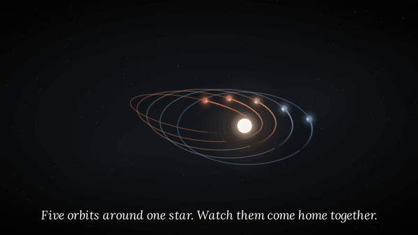

# Math To Manim

**Turn a mathematical question into an animated explanation.**

Math To Manim develops a learning brief, checks the mathematics, plans the visual
story, writes a Manim scene, and reviews the rendered result. Explore the films,
or use the Astra pipeline to make your own.

[Watch the films](docs/showcase/README.md) · [Get started](#make-your-first-film) · [Project guide](docs/PROJECT_GUIDE.md) · [Research films](papers/README.md)

<a href="docs/showcase/assets/every-orbit-great-circle.mp4">
  <picture>
    <source media="(prefers-reduced-motion: reduce)" srcset="docs/showcase/assets/every-orbit-great-circle-poster.png" />
    
  </picture>
</a>

*Every Orbit Is a Great Circle* — orbital motion becomes geometry on a sphere.
[Watch the film](docs/showcase/assets/every-orbit-great-circle.mp4) · [How it was made](docs/showcase/every-orbit-great-circle/README.md)

## Explore the films

| Film | The visual idea | Watch / explore |
| --- | --- | --- |
| From Score SDEs to One-Step Consistency | Noise, probability flow, and a path back to data | [Film and production record](docs/showcase/score-sde-consistency/README.md) |
| The Shape and Its Shadow | A cube, its polar octahedron, and their volume product | [Film and source](papers/mahler/README.md) |
| A Frontier for the Zeros | Zeta landscapes and a manuscript's proposed zero-free frontier | [Film and source](papers/quasi-riemann/README.md) |
| Morse Theory | Four critical moments change the topology of a torus | [Film and production record](docs/showcase/astra-morse-torus/README.md) |

Research films explain their source manuscripts; they do not independently certify
those manuscripts' claims. See each production record for review scope.

[Browse the full motion showcase →](docs/showcase/README.md)

## Make your first film

Install Python 3.10+, Node.js 18+, and the Manim rendering dependencies, including
FFmpeg and LaTeX. The [setup guide](docs/PROJECT_GUIDE.md#installation) covers
Windows, macOS, Linux, and installation from source.

```bash
python -m pip install "math-to-manim[astra] @ https://github.com/HarleyCoops/Math-To-Manim/releases/download/v2.0.0/math_to_manim-2.0.0-py3-none-any.whl"
math-to-manim setup
math-to-manim login
math-to-manim doctor --review-mode off
math-to-manim run "Explain the geometry of a torus" -q m --review-mode off
```

Astra uses your Codex ChatGPT login. This example keeps independent Astra audits
and skips Jev. Jev reviews are advisory by default when enabled; strict gates are
opt-in. [Review modes and architecture](docs/ASTRA_PIPELINE.md).

## How it works

**Question → learning brief → mathematics → storyboard → scene → rendered film**

Each run retains its source, candidate attempts, reviews, render logs, sampled
frames, and completion manifest. You can inspect the evidence and resume work.
The primary `math-to-manim` command runs Astra; other provider pipelines have
[their own commands](docs/PROJECT_GUIDE.md#provider-pipelines-and-films).

## Go deeper

- [Complete project guide](docs/PROJECT_GUIDE.md) — setup, review modes, testing, and project history.
- [Astra bundle](docs/ASTRA_BUNDLE.md) — packaged runtime and completed film assets.
- [Mathematics in 3D](papers/README.md) — research episodes and source dossiers.
- [Visual inventory](docs/showcase/VISUAL_INVENTORY.md) — existing animations and candidates for future features.
- [Contributing guidance](AGENTS.md) · [MIT license](LICENSE).

<details>
<summary>Project history and stars</summary>

Math To Manim began on January 20, 2025, exploring how recursive reasoning could
turn mathematical ideas into visual explanations. [Read the story](docs/PROJECT_GUIDE.md#the-morning-of-january-20-2025).

<a href="https://www.star-history.com/?repos=HarleyCoops%2FMath-To-Manim&type=date&legend=top-left">
  <picture>
    <source media="(prefers-color-scheme: dark)" srcset="https://api.star-history.com/chart?repos=HarleyCoops/Math-To-Manim&type=date&theme=dark&legend=top-left&sealed_token=EjITEOSI8nKcGNkepdjUHZ8WTRNOw4dKGtyggkiM_yrNBnjxIr00U2Pgt5DqaUF8Qgx4-WIhM4WdOM2ipFiXTXOJxhJU87yp_iOKrGOHkaIBES1Wrpn1f7i_TMd8chdgnaa09DKge1DJ93Hwe4MmjX0YO1PpzSsDF9ebqWr0MDDTnpRzPNbPUvweMI00" />
    <source media="(prefers-color-scheme: light)" srcset="https://api.star-history.com/chart?repos=HarleyCoops/Math-To-Manim&type=date&legend=top-left&sealed_token=EjITEOSI8nKcGNkepdjUHZ8WTRNOw4dKGtyggkiM_yrNBnjxIr00U2Pgt5DqaUF8Qgx4-WIhM4WdOM2ipFiXTXOJxhJU87yp_iOKrGOHkaIBES1Wrpn1f7i_TMd8chdgnaa09DKge1DJ93Hwe4MmjX0YO1PpzSsDF9ebqWr0MDDTnpRzPNbPUvweMI00" />
    
  </picture>
</a>

</details>
