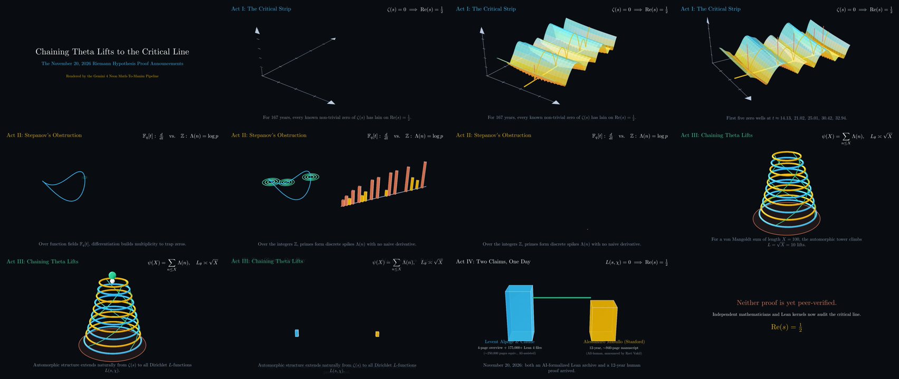

# Math-To-Manim

**Turn frontier mathematics into verified 3D Manim & Blender films in a single CLI call.**

[](https://colab.research.google.com/github/HarleyCoops/Math-To-Manim/blob/main/notebooks/math_to_manim_neon_colab.ipynb)
[](https://harleycoops.github.io/Math-To-Manim/)
[](https://github.com/HarleyCoops/Math-To-Manim/releases/tag/riemann-hypothesis-film-2026-11-20)
[](LICENSE)

[](https://github.com/HarleyCoops/Math-To-Manim/releases/download/riemann-hypothesis-film-2026-11-20/riemann-hypothesis-2026.mp4)

> **[Watch the 720p30 MP4 (52.4s)](https://github.com/HarleyCoops/Math-To-Manim/releases/download/riemann-hypothesis-film-2026-11-20/riemann-hypothesis-2026.mp4)** · **[Open Playable Multi-Model Gallery](https://harleycoops.github.io/Math-To-Manim/)** · **[Try Zero-Install in Colab](https://colab.research.google.com/github/HarleyCoops/Math-To-Manim/blob/main/notebooks/math_to_manim_neon_colab.ipynb)** · **[Full Film Archive](docs/SHOWCASE.md)**

---

## 3-Line Quickstart (Gemini 4 Neon CLI)

```bash
pip install -e ".[render]" google-genai
math-to-manim-neon doctor
math-to-manim-neon run "Explain the Nov 2026 Riemann Hypothesis proofs" --render -q m --publish
```

No local Manim/LaTeX setup? Click **[Open in Colab](https://colab.research.google.com/github/HarleyCoops/Math-To-Manim/blob/main/notebooks/math_to_manim_neon_colab.ipynb)** to render a 3D scene directly in your browser.

---

## Multi-Model Frontier Films

Each frontier model runs inside its own isolated provider silo (`src/<silo>/`, enforced by `tests/test_silo_boundaries.py`), taking a mathematical topic or raw sketch all the way to verified 3D code and MP4:

| Film | Model / Silo | Length | Watch / Inspect |
|---|---|---:|---|
| **Chaining Theta Lifts to the Critical Line** *(Nov 20, 2026 GRH)* | Gemini 4 Neon (`src/neon/`) | 52.4 s | [MP4 Release](https://github.com/HarleyCoops/Math-To-Manim/releases/download/riemann-hypothesis-film-2026-11-20/riemann-hypothesis-2026.mp4) · [Contact Sheet](docs/assets/riemann-hypothesis-2026/contact-sheet.png) · [Source](docs/assets/riemann-hypothesis-2026/src/riemann_hypothesis_2026.py) |
| **Base 12 Computer: From a Notebook Sketch** | Claude Fable 5.2 (`src/mythos/`) | 104 s | [MP4](docs/assets/base12-computer/base12-computer-journey.mp4) · [Sketch](docs/assets/base12-computer/sketch.jpg) · [Source](docs/assets/base12-computer/src/base12_computer_journey.py) |
| **Altermagnetism** & **Unit Distance Disproof** | Claude Fable 5.2 (`src/studio/`) | 37–39 s | [Altermagnetism MP4](docs/showcase/assets/studio-altermagnetism.mp4) · [Unit Distance MP4](docs/showcase/assets/studio-unit-distance.mp4) |
| **Every Dial Has a Loose Switch** *(Aaronson–Ambainis)* | Claude Opus 5.5 (`src/mythos/`) | 10 min | [GIF](docs/assets/loose-switch/loose-switch-journey.gif) · [Contact Sheet](docs/assets/loose-switch/contact-sheet.png) |
| **From Score SDEs to One-Step Consistency** | Gemini 4 Argon (`src/argon/`) | 70.4 s | [MP4](docs/showcase/assets/score-sde-consistency.mp4) · [Source](examples/argon/score_sde_consistency.py) · [Dossier](docs/showcase/score-sde-consistency/README.md) |
| **A Frontier for the Zeros** *(Quasi-Riemann)* | GPT-6 Astra + Jev (`src/astra/`) | 221 s | [MP4 Release](https://github.com/HarleyCoops/Math-To-Manim/releases/download/quasi-riemann-film-2026-10-07/quasi-riemann-720p.mp4) |

See **[docs/SHOWCASE.md](docs/SHOWCASE.md)** for the complete archive of films, Studio Blender+Manim comparisons, Mythos MCP docs, and legacy installation guides.

---

## Featured: Chaining Theta Lifts to the Critical Line (`math-to-manim-neon`)

On **November 20, 2026**, two separate claimed proofs of the Generalized Riemann Hypothesis were announced on the same day:
- **Levent Alpöge & Claude (Anthropic):** 4-page overview + **175,000+ Lean 4 files** (~250,000 pages equivalent) bypassing the missing integer derivative in Stepanov's method by chaining roughly $\sqrt{X}$ automorphic theta lifts for a von Mangoldt sum of length $X$.
- **Alessandro Masullo (Stanford, announced by Ravi Vakil):** 12-year, **~940-page** all-human manuscript vetted by Brian Conrad.

Both claims are newly announced and await independent peer and formal-kernel verification.

### How the Gemini 4 Neon-first CLI (`src/neon/`) works

Instead of splitting reasoning across six sequential JSON-handoff stages, `math-to-manim-neon` unifies planning, numerical verification, codegen, static scene checks, Manim rendering, and showcase publishing into **one CLI call**:

- **Pluggable Neon backends (`src/neon/backends.py`):** native `google-genai` SDK (`gemini-4-neon` with `ThinkingConfig` + live function calling), official `gemini-api` CLI, or session-driven `operator` mode.
- **First-class toolbelt (`src/neon/tools.py`):**
  - `verify_math`: sandboxed real & complex NumPy/AST numerical evaluator.
  - `check_scene`: AST syntax, `ThreeDScene` camera discipline, and banned-import guard.
  - `render_scene`: secret-scrubbed Manim render + `ffprobe` + 12-frame contact sheet & highlights GIF.
  - `publish_film`: writes showcase assets and production logs (`01_neon_plan.json`, `tool_calls.jsonl`, `validation.json`, `manifest.json`).
- **This film:** `RiemannThetaLiftJourney` (421 lines) passed all 5 `verify_math` checks and `check_scene` with **0 repairs** (`outcome: film_published`).



---

## Featured: Base 12 Computer — From a Notebook Sketch

[](docs/assets/base12-computer/base12-computer-journey.mp4)

[Watch the complete film (104 s, 720p30)](docs/assets/base12-computer/base12-computer-journey.mp4) ·
[Original pencil sketch](docs/assets/base12-computer/sketch.jpg) ·
[Generated ThreeDScene (316 lines)](docs/assets/base12-computer/src/base12_computer_journey.py)

Made from a single photograph of a notebook page with zero formulas written on it: Claude Fable 5.2 recognized $K_{12}$ with $\binom{12}{2}=66$ wires, folded it onto an icosahedron ($66 = 30 + 30 + 6$), and rendered a base-12 counter on the first attempt with zero repairs.

---

## Architecture & Testing

Every provider lives in an independent silo under `src/` (`neon`, `studio`, `mythos`, `argon`, `astra`, `grok`, `glm`, `mimo`, `sol`) with strict zero-cross-import boundaries:

```bash
pytest tests/test_silo_boundaries.py tests/test_neon_silo.py
```

Full documentation for all silos, Studio (Blender EEVEE + Manim), Mythos MCP, and Astra+Jev lives in **[docs/SHOWCASE.md](docs/SHOWCASE.md)**.

---

<a href="https://www.star-history.com/?repos=HarleyCoops%2FMath-To-Manim&type=date&legend=top-left">
  <picture>
    <source media="(prefers-color-scheme: dark)" srcset="https://api.star-history.com/chart?repos=HarleyCoops/Math-To-Manim&type=date&theme=dark&legend=top-left&sealed_token=EjITEOSI8nKcGNkepdjUHZ8WTRNOw4dKGtyggkiM_yrNBnjxIr00U2Pgt5DqaUF8Qgx4-WIhM4WdOM2ipFiXTXOJxhJU87yp_iOKrGOHkaIBES1Wrpn1f7i_TMd8chdgnaa09DKge1DJ93Hwe4MmjX0YO1PpzSsDF9ebqWr0MDDTnpRzPNbPUvweMI00" />
    <source media="(prefers-color-scheme: light)" srcset="https://api.star-history.com/chart?repos=HarleyCoops/Math-To-Manim&type=date&legend=top-left&sealed_token=EjITEOSI8nKcGNkepdjUHZ8WTRNOw4dKGtyggkiM_yrNBnjxIr00U2Pgt5DqaUF8Qgx4-WIhM4WdOM2ipFiXTXOJxhJU87yp_iOKrGOHkaIBES1Wrpn1f7i_TMd8chdgnaa09DKge1DJ93Hwe4MmjX0YO1PpzSsDF9ebqWr0MDDTnpRzPNbPUvweMI00" />
    
  </picture>
</a>

## License

MIT — see [LICENSE](LICENSE).
