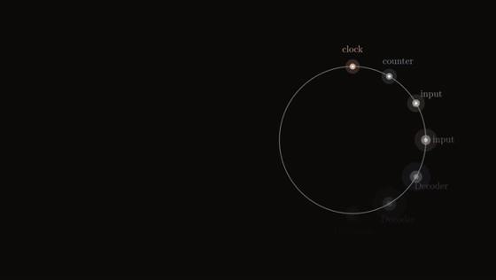

# Math-To-Manim

<a href="https://www.star-history.com/?repos=HarleyCoops%2FMath-To-Manim&type=date&legend=top-left">
  <picture>
    <source media="(prefers-color-scheme: dark)" srcset="https://api.star-history.com/chart?repos=HarleyCoops/Math-To-Manim&type=date&theme=dark&legend=top-left&sealed_token=EjITEOSI8nKcGNkepdjUHZ8WTRNOw4dKGtyggkiM_yrNBnjxIr00U2Pgt5DqaUF8Qgx4-WIhM4WdOM2ipFiXTXOJxhJU87yp_iOKrGOHkaIBES1Wrpn1f7i_TMd8chdgnaa09DKge1DJ93Hwe4MmjX0YO1PpzSsDF9ebqWr0MDDTnpRzPNbPUvweMI00" />
    <source media="(prefers-color-scheme: light)" srcset="https://api.star-history.com/chart?repos=HarleyCoops/Math-To-Manim&type=date&legend=top-left&sealed_token=EjITEOSI8nKcGNkepdjUHZ8WTRNOw4dKGtyggkiM_yrNBnjxIr00U2Pgt5DqaUF8Qgx4-WIhM4WdOM2ipFiXTXOJxhJU87yp_iOKrGOHkaIBES1Wrpn1f7i_TMd8chdgnaa09DKge1DJ93Hwe4MmjX0YO1PpzSsDF9ebqWr0MDDTnpRzPNbPUvweMI00" />
    
  </picture>
</a>

## Featured: The Mix That Cannot Kill a Pole (film, paper and Lean file)

[![Ten scenes from the film, 40 seconds: two copies slide right by log 2 and log 4; three weighted curves merge into the curve D; a coral spiral grows along its axis; three arrows −1, 3q and −2q² are laid head to tail and do not close; a larger ivory spiral grows around the coral one; the camera dives into 1/2 < |q| < 1; a flat annulus winds up into a three-turn ribbon; two red rods rise through the ribbon and touch only its edges; the surface |m(s)| rises from the floor of the strip; the camera pulls back until five stations stand in one row.](docs/showcase/assets/pole-survives-the-mix.gif)](docs/showcase/assets/pole-survives-the-mix.mp4)

> **[Watch the film (720p, 264 s)](docs/showcase/assets/pole-survives-the-mix.mp4)** · **[Paper (PDF)](docs/showcase/pole-survives-the-mix/paper.pdf)** · **[Lean file](docs/showcase/pole-survives-the-mix/DelayedPoleSurvival.lean)** · **[Manim source](examples/mythos/pole_survives_the_mix.py)** · **[Stage artifacts and run record](docs/showcase/pole-survives-the-mix/README.md)**

Take a curve g. Make three copies. Delay two of them by log 2 and log 4. Add the copies with weights −1, 3 and −2.
The weights sum to zero, so the mix cancels things. It does not cancel a pole of the transform of g that lies inside the critical strip 0 < Re s < 1.
This 4-minute film shows why, in one continuous 3D world with five stations. The run also wrote an 11-page paper and a Lean file that prove the same statement.
**Credit.** The question and the mathematics are Lee Crossley's. All credit goes to his Lean file [`DelayedPole.lean`](https://github.com/leecrossley/prime-window-rh-criterion/blob/main/results/dirichlet-window-transfer/DelayedPole.lean) in [prime-window-rh-criterion](https://github.com/leecrossley/prime-window-rh-criterion). The film, the paper and the Lean file here only explain his result.
His result is one step of a conditional criterion. It is not a proof of the Riemann hypothesis.

![Collage of twelve frames from the film: the title; three delayed and weighted copies that merge into one curve D(u); the spiral tone of the first zeta zero and its floor shadow; the larger ivory spiral that the mix returns; the headline "A delay becomes a multiplication"; the camera inside the factor (1 − q); a gold circle that shrinks between the circles |q| = 1 and |q| = 1/2; the two kill points on those circles; the strip wound into a ribbon with two red rods; the surface |m(s)| over the strip; the residue rule on the floor; the five stations in one row with the end card.](docs/showcase/assets/pole-survives-the-mix-contact-sheet.png)

---

## The wall: 20 earlier films

Math-To-Manim turns frontier mathematics into verified 3D Manim and Blender films in a single CLI call.
The film above is the newest one. These are 20 of the films that came before it.

[![Animated wall of 20 earlier films in a grid of 4 columns and 5 rows, each tile an 8-second loop: 01 Chaining Theta Lifts to the Critical Line; 02 Base 12 Computer; 03 From Score SDEs to One-Step Consistency; 04 Every Orbit Is a Great Circle; 05 Morse Theory on a Torus; 06 The Shape and Its Shadow; 07 The Third Side; 08 Every Dial Has a Loose Switch; 09 The Traitor Axis; 10 Exceptional-point monodromy; 11 The Valley; 12 Vortex; 13 The Associate Family; 14 Holonomy; 15 The Last Day; 16 QED in Minkowski Spacetime; 17 Hopf Fibration; 18 Lorenz Attractor; 19 Rhombicosidodecahedron; 20 Area of a Circle.](docs/showcase/assets/gif-wall.gif)](docs/SHOWCASE.md)

- **01** [Chaining Theta Lifts to the Critical Line](https://github.com/HarleyCoops/Math-To-Manim/releases/download/riemann-hypothesis-film-2026-11-20/riemann-hypothesis-2026.mp4) · **02** [Base 12 Computer](docs/assets/base12-computer/base12-computer-journey.mp4) · **03** [From Score SDEs to One-Step Consistency](docs/showcase/assets/score-sde-consistency.mp4) · **04** [Every Orbit Is a Great Circle](docs/showcase/assets/every-orbit-great-circle.mp4)
- **05** [Morse Theory on a Torus](docs/showcase/assets/astra-morse-torus.mp4) · **06** [The Shape and Its Shadow](docs/showcase/assets/mahler-film.mp4) · **07** [The Third Side](docs/showcase/assets/the-third-side.mp4) · **08** [Every Dial Has a Loose Switch](docs/assets/loose-switch/loose-switch-journey.gif)
- **09** [The Traitor Axis](docs/showcase/assets/traitor-axis.gif) · **10** [Exceptional-point monodromy](docs/showcase/assets/exceptional-point-monodromy.gif) · **11** [The Valley](docs/showcase/assets/the-valley.gif) · **12** [Vortex](docs/showcase/assets/vortex-leapfrog.gif)
- **13** [The Associate Family](docs/showcase/assets/associate-family-riso.gif) · **14** [Holonomy](docs/showcase/assets/blueprint-holonomy.gif) · **15** [The Last Day](docs/showcase/assets/the-last-day.gif) · **16** [QED in Minkowski Spacetime](docs/showcase/assets/qed-minkowski-epic-3d.gif)
- **17** [Hopf Fibration](docs/showcase/assets/hopf-fibration.gif) · **18** [Lorenz Attractor](docs/showcase/assets/lorenz-attractor.gif) · **19** [Rhombicosidodecahedron](docs/showcase/assets/rhombicosidodecahedron.gif) · **20** [Area of a Circle](docs/showcase/assets/circle-area-3d-unwrapped.gif)

The numbers are the tile numbers. A link opens the full MP4, or the full GIF when the repo has no MP4.
Also in the archive: [Altermagnetism](docs/showcase/assets/studio-altermagnetism.mp4), [Unit Distance Disproof](docs/showcase/assets/studio-unit-distance.mp4) and [A Frontier for the Zeros](https://github.com/HarleyCoops/Math-To-Manim/releases/download/quasi-riemann-film-2026-10-07/quasi-riemann-720p.mp4).

The newer films come from separate model silos under `src/`: Claude Fable 5.2 and Claude Opus 5.5 (`mythos`, `studio`), Gemini 4 Neon (`neon`), Gemini 4 Argon (`argon`), and GPT-6 Astra with Jev (`astra`).
See **[docs/SHOWCASE.md](docs/SHOWCASE.md)** for the complete archive of films, Studio Blender+Manim comparisons, Mythos MCP docs, and installation guides.
To rebuild the wall from the GIFs in the repo, run `python scripts/build_gif_wall.py`.

[](https://colab.research.google.com/github/HarleyCoops/Math-To-Manim/blob/main/notebooks/math_to_manim_neon_colab.ipynb)
[](https://harleycoops.github.io/Math-To-Manim/)
[](https://github.com/HarleyCoops/Math-To-Manim/releases/tag/riemann-hypothesis-film-2026-11-20)
[](LICENSE)

---

## The Mix That Cannot Kill a Pole: how it was made, the paper and the Lean file

### How it was made

- The input was Lee Crossley's question, with his [`DelayedPole.lean`](https://github.com/leecrossley/prime-window-rh-criterion/blob/main/results/dirichlet-window-transfer/DelayedPole.lean) as context. The art direction was: one 3D world, and a zoom into every formula.
- A Claude Fable 5.2 session answered the six Mythos stages and codegen through `scripts/operate_mythos_chain.py`. The harness validated each reply.
- The chain wrote one Manim `ThreeDScene`, `PoleSurvivesTheMixJourney` (844 lines). The static check rejected the first version: six `\tfrac12` fragments had no braces.
- The harness rendered 187 animations at 1920 × 1080, 60 fps, in 891 seconds. The film is 264 seconds long. The GIF at the top of this page is 40 seconds of it.
- Two new companion stages wrote the paper and the Lean file ([`docs/MYTHOS_COMPANIONS.md`](docs/MYTHOS_COMPANIONS.md)). The harness compiled the paper with pdflatex and checked the Lean file with Lean 4.33.1 and Mathlib.
- The film has no narration. No independent reviewer checked the film or the paper.

### The calculation, in the paper


The mix, with delays that are zero before they start:

$$D(u) = -g(u) + 3\,g(u-\log 2) - 2\,g(u-\log 4)$$

A delay by $a$ multiplies the Laplace transform by $e^{-sa}$. So the mix multiplies the transform by one function, the symbol. Write $q = 2^{-s}$:

$$m(s) = -1 + 3\cdot 2^{-s} - 2\cdot 4^{-s} = -1 + 3q - 2q^2 = (1-q)(2q-1)$$

The symbol is zero only when $q = 1$ or $q = \tfrac{1}{2}$. The size of $q$ depends only on the real part of $s$:

$$|q| = 2^{-\mathrm{Re}\,s}, \qquad 0 < \mathrm{Re}\,s < 1 \;\Longrightarrow\; \tfrac{1}{2} < |q| < 1$$

So every zero of $m$ is on a wall of the strip, and no zero is inside:

$$m(s) = 0 \iff s = \frac{2\pi i k}{\log 2} \ \text{ or }\ s = 1 + \frac{2\pi i k}{\log 2}, \quad k \in \mathbb{Z}$$

The triangle inequality gives a floor and a ceiling on each vertical line $\mathrm{Re}\,s = \sigma$, with $x = 2^{-\sigma}$:

$$(1-x)(2x-1) \;\le\; |m(\sigma + it)| \;\le\; (1+x)(2x+1)$$

Near a pole, the transform is $r/(s-\rho)$ plus an analytic part. The symbol is entire, so the pole stays and only the residue changes:

$$m(s)\,\frac{r}{s-\rho} = \frac{m(\rho)\,r}{s-\rho} + r\,\frac{m(s)-m(\rho)}{s-\rho}, \qquad m(\rho)\,r \ne 0$$

The worked example of the paper, at the first zeta zero $\rho_1 = \tfrac{1}{2} + 14.134725\,i$:

| Quantity | Value |
|---|---|
| $q = 2^{-\rho_1}$ | $-0.658571 + 0.257458\,i$ |
| $\lvert q\rvert = 2^{-1/2}$, $\arg q$ | $0.707107$, $158.648^\circ$ |
| $1 - q$ | $1.658571 - 0.257458\,i$ |
| $2q - 1$ | $-2.317141 + 0.514916\,i$ |
| $m(\rho_1) = (1-q)(2q-1)$ | $-3.710574 + 1.450591\,i$ |
| $\lvert m(\rho_1)\rvert$ | $3.984040$ |
| floor and ceiling on the critical line, $3/\sqrt2 \mp 2$ | $0.121320$ and $4.121320$ |
| residue of the transform at $\rho_1$, $1/(\tfrac{1}{4} + \gamma_1^2)$ | $0.004999$ |
| size of the residue after the mix | $0.019916$ |

The pole of the first zeta zero becomes about 4 times larger. The paper also shows that the two zeros on the walls are necessary: they are what makes the weight of the mix a compact tent on (1, 4).

### The same calculation, in Lean

The file [`DelayedPoleSurvival.lean`](docs/showcase/pole-survives-the-mix/DelayedPoleSurvival.lean) imports only Mathlib. It has no `sorry`. Its theorems use the axioms `propext`, `Classical.choice` and `Quot.sound` only.

The Lean reference is Lee Crossley's [`DelayedPole.lean`](https://github.com/leecrossley/prime-window-rh-criterion/blob/main/results/dirichlet-window-transfer/DelayedPole.lean) (CC BY 4.0). Read his file first: it is the original, and it has the application to Dirichlet families that our file does not have.
Our file restates his definitions `delay`, `compactDifference` (here `mix`) and `symbol`. It adapts his proofs of `laplace_delay`, `symbol_real` (here `symbol_pos_of_real`) and `compactDifference_poleData` (here `mix_poleData`).

The three definitions:

```lean
/-- Delay `g` by `a`, and put zero where the delayed curve has not started. -/
def delay (a : ℝ) (g : ℝ → ℝ) (u : ℝ) : ℝ := if a < u then g (u - a) else 0

/-- Three copies of `g` with delays `0`, `c`, `2c` and weights `-1`, `3`, `-2`. -/
def mix (c : ℝ) (g : ℝ → ℝ) (u : ℝ) : ℝ :=
  -delay 0 g u + 3 * delay c g u - 2 * delay (2 * c) g u

/-- The multiplier of the mix on the Laplace side. With `c = log 2` and
`q = 2^(-s)` this is `(1 - q)(2q - 1)`. -/
def symbol (c : ℝ) (s : ℂ) : ℂ := (1 - cexp (-s * c)) * (2 * cexp (-s * c) - 1)
```

The radius of q, and the strip that goes into the annulus:

```lean
/-- `|e^(-sc)| = e^(-Re(s) c)`: the radius of `q` depends only on `Re s`. -/
theorem norm_q (c : ℝ) (s : ℂ) : ‖cexp (-s * (c : ℂ))‖ = Real.exp (-s.re * c) := by
  simp [Complex.norm_exp]

/-- The strip `0 < Re s < 1` goes into the open annulus `1/2 < |q| < 1`. -/
theorem q_mem_annulus {s : ℂ} (h0 : 0 < s.re) (h1 : s.re < 1) :
    1 / 2 < ‖cexp (-s * (Real.log 2 : ℂ))‖ ∧ ‖cexp (-s * (Real.log 2 : ℂ))‖ < 1 := by
  rw [norm_q]; exact radius_bounds h0 h1
```

The floor (statement only; the proof is 12 lines), and the theorem that the symbol has no zero inside the strip:

```lean
/-- The quantitative floor: on the line `Re s = σ`, `0 < σ < 1`,
`|m(s)| ≥ (1 - 2^(-σ)) (2·2^(-σ) - 1) > 0`. -/
theorem symbol_norm_lower {s : ℂ} (h0 : 0 < s.re) (h1 : s.re < 1) :
    (1 - Real.exp (-s.re * Real.log 2)) * (2 * Real.exp (-s.re * Real.log 2) - 1)
      ≤ ‖symbol (Real.log 2) s‖

/-- **No blind spot inside the strip.** The symbol has no zero with `0 < Re s < 1`. -/
theorem symbol_ne_zero {s : ℂ} (h0 : 0 < s.re) (h1 : s.re < 1) :
    symbol (Real.log 2) s ≠ 0 :=
  norm_pos_iff.mp (lt_of_lt_of_le (floor_pos h0 h1) (symbol_norm_lower h0 h1))
```

The pole survives:

```lean
/-- **The pole survives the mix.** A simple pole of `Φ` at a point `ρ` of the
open strip, with residue `r ≠ 0`, is a simple pole of `m·Φ` with the nonzero
residue `m(ρ) r`. -/
theorem pole_survives_mix {Φ h : ℂ → ℂ} {ρ r : ℂ} (h0 : 0 < ρ.re) (h1 : ρ.re < 1)
    (hr : r ≠ 0) (hh : AnalyticAt ℂ h ρ)
    (hΦ : ∀ᶠ s in 𝓝[≠] ρ, Φ s = r / (s - ρ) + h s) :
    symbol (Real.log 2) ρ * r ≠ 0 ∧ ∃ h' : ℂ → ℂ, AnalyticAt ℂ h' ρ ∧
      ∀ᶠ s in 𝓝[≠] ρ, symbol (Real.log 2) s * Φ s =
        (symbol (Real.log 2) ρ * r) / (s - ρ) + h' s :=
  ⟨mul_ne_zero (symbol_ne_zero h0 h1) hr,
    pole_transfer (symbol_differentiable _) hh hΦ⟩
```

The file also evaluates the numbers in floating point. This is a test, not a proof. The comment on each `#eval` line is the value that Lean printed:

```lean
/-- `q = 2^(-s)` at `s = σ + i t`: radius `2^(-σ)`, angle `-t log 2`. -/
def q (σ t : Float) : Cx :=
  let r := Float.exp (-(σ * log2))
  ⟨r * Float.cos (t * log2), -(r * Float.sin (t * log2))⟩

/-- The symbol `m(s) = (1 - q)(2q - 1)` at `s = σ + i t`. -/
def symbolF (σ t : Float) : Cx :=
  let z := q σ t
  Cx.mul ⟨1 - z.re, -z.im⟩ ⟨2 * z.re - 1, 2 * z.im⟩

#eval (q 0.5 gamma1).re                     -- -0.658571
#eval (q 0.5 gamma1).im                     -- 0.257458
#eval (q 0.5 gamma1).abs                    -- 0.707107
#eval (symbolF 0.5 gamma1).re               -- -3.710574
#eval (symbolF 0.5 gamma1).im               -- 1.450591
#eval (symbolF 0.5 gamma1).abs              -- 3.984040
#eval floorF 0.5                            -- 0.121320
#eval gridMinRatio                          -- 1.000000
#eval gridMinAbs                            -- 0.003454
#eval 2 * 3.141592653589793 / log2          -- 9.064720
```

More theorems are in the file: `laplace_delay` and `laplace_mix` (a delay, and the mix, are multiplications on the Laplace side), `symbol_zero_left` and `symbol_zero_right` (both walls carry zeros), `tent_eq` (the tent weight), and `mix_poleData`, a Mathlib-only version of Crossley's `compactDifference_poleData`.
The numbers of the scene are tested in [`tests/test_pole_survives_the_mix.py`](tests/test_pole_survives_the_mix.py).

---

## Featured: Chaining Theta Lifts to the Critical Line (`math-to-manim-neon`)

On **November 20, 2026**, two separate claimed proofs of the Generalized Riemann Hypothesis were announced on the same day:
- **Levent Alpöge & Claude (Anthropic):** 4-page overview + **175,000+ Lean 4 files** (~250,000 pages equivalent) bypassing the missing integer derivative in Stepanov's method by chaining roughly $\sqrt{X}$ automorphic theta lifts for a von Mangoldt sum of length $X$.
- **Alessandro Masullo (Stanford, announced by Ravi Vakil):** 12-year, **~940-page** all-human manuscript vetted by Brian Conrad.

Both claims are newly announced and await independent peer and formal-kernel verification.

### How the Gemini 4 Neon-first CLI (`src/neon/`) works

Instead of splitting reasoning across six sequential JSON-handoff stages, `math-to-manim-neon` unifies planning, numerical verification, codegen, static scene checks, Manim rendering, and showcase publishing into **one CLI call**:

- **Pluggable Neon backends (`src/neon/backends.py`):** native `google-genai` SDK (`gemini-4-neon` with `ThinkingConfig` + live function calling), official `gemini-api` CLI, or session-driven `operator` mode.
- **First-class toolbelt (`src/neon/tools.py`):**
  - `verify_math`: sandboxed real & complex NumPy/AST numerical evaluator.
  - `check_scene`: AST syntax, `ThreeDScene` camera discipline, and banned-import guard.
  - `render_scene`: secret-scrubbed Manim render + `ffprobe` + 12-frame contact sheet & highlights GIF.
  - `publish_film`: writes showcase assets and production logs (`01_neon_plan.json`, `tool_calls.jsonl`, `validation.json`, `manifest.json`).
- **This film:** `RiemannThetaLiftJourney` (421 lines) passed all 5 `verify_math` checks and `check_scene` with **0 repairs** (`outcome: film_published`).


---

## Featured: Base 12 Computer — From a Notebook Sketch

[](docs/assets/base12-computer/base12-computer-journey.mp4)

[Watch the complete film (104 s, 720p30)](docs/assets/base12-computer/base12-computer-journey.mp4) ·
[Original pencil sketch](docs/assets/base12-computer/sketch.jpg) ·
[Generated ThreeDScene (316 lines)](docs/assets/base12-computer/src/base12_computer_journey.py)

Made from a single photograph of a notebook page with zero formulas written on it: Claude Fable 5.2 recognized $K_{12}$ with $\binom{12}{2}=66$ wires, folded it onto an icosahedron ($66 = 30 + 30 + 6$), and rendered a base-12 counter on the first attempt with zero repairs.

---

## Architecture & Testing

Every provider lives in an independent silo under `src/` (`neon`, `studio`, `mythos`, `argon`, `astra`, `grok`, `glm`, `mimo`, `sol`) with strict zero-cross-import boundaries:

```bash
pytest tests/test_silo_boundaries.py tests/test_neon_silo.py
```

Full documentation for all silos, Studio (Blender EEVEE + Manim), Mythos MCP, and Astra+Jev lives in **[docs/SHOWCASE.md](docs/SHOWCASE.md)**.

---

## License

MIT — see [LICENSE](LICENSE).
