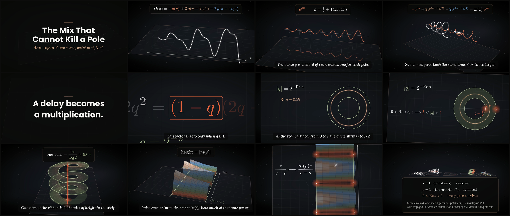

# The Mix That Cannot Kill a Pole

Take a curve $g$. Make three copies. Delay two of them by $\log 2$ and
$\log 4$. Add the copies with weights $-1$, $3$ and $-2$:

$$D(u) = -g(u) + 3\,g(u-\log 2) - 2\,g(u-\log 4).$$

The weights sum to zero, so the mix cancels things. It does not cancel a pole
of the transform of $g$ that lies inside the critical strip $0<\mathrm{Re}\,s<1$.
The film shows why, in one continuous 3D world with five stations.

**264 s, rendered at 1920 × 1080, 60 fps** by the harness renderer (891 s on one core). The committed MP4 is re-encoded at 1280 × 720, 30 fps (13.5 MB) to keep the repository small; the 1080p60 master (45.6 MB) is in the run directory `runs/mythos/20261122-183142-use-the-fable-pipeline-build-3-copies-of-a-curve/`.

[Film](../assets/pole-survives-the-mix.mp4) ·
[Preview GIF](../assets/pole-survives-the-mix.gif) ·
[Paper pages (image)](../assets/pole-survives-the-mix-paper-pages.png) ·
[Manim source](../../../examples/mythos/pole_survives_the_mix.py) ·
[Paper (PDF)](paper.pdf) · [Paper (LaTeX)](paper.tex) ·
[Lean file](DelayedPoleSurvival.lean) ·
[Contact sheet](../assets/pole-survives-the-mix-contact-sheet.png) ·
[Production prompt](prompt.txt)

**Credit.** The question and the mathematics are Lee Crossley's. All credit goes to his Lean file
[`DelayedPole.lean`](https://github.com/leecrossley/prime-window-rh-criterion/blob/main/results/dirichlet-window-transfer/DelayedPole.lean)
in [prime-window-rh-criterion](https://github.com/leecrossley/prime-window-rh-criterion) (CC BY 4.0).
The film, the paper and the Lean file here only explain his result. His result is one step of a
conditional criterion. The film does not prove a zero-free region or the Riemann hypothesis, and the end card says so.



## The argument, station by station

| Station | What the viewer sees | The claim |
|---|---|---|
| 1 Lanes | One curve splits into three lanes. Two copies slide right by $\log 2$ and $\log 4$. The heights stretch to $-1$, $3$, $-2$ times. The lanes merge into one ivory curve. | The definition of the mix $D$, with delays that are zero before they start. |
| 2 Spiral | A coral spiral $e^{\rho u}$ for the first zeta zero, $\rho = \tfrac12 + 14.1347\,i$. Its floor shadow is a wave. A gold copy slides by $\log 2$. Seen along the axis, three arrows $-1$, $3q$, $-2q^2$ lie head to tail and do not close. | A pole at $\rho$ is one tone $e^{\rho u}$. A delay multiplies the tone by $q = 2^{-\rho}$. The mix multiplies it by $m(\rho) = -1+3q-2q^2$; here $\lvert m(\rho)\rvert = 3.984$. |
| 3 Board | $m(s) = -1 + 3\cdot 2^{-s} - 2\cdot 4^{-s}$ on the floor; the camera visits each term, then each factor of $(1-q)(2q-1)$. | The mix can remove a tone only when $q = 1$ or $q = \tfrac12$. |
| 4 Ribbon | A gold circle shrinks from radius 1 to $\tfrac12$ as $\mathrm{Re}\,s$ goes from 0 to 1. The camera dives into $\tfrac12 < \lvert q\rvert < 1$. The annulus winds into a ribbon with height $\mathrm{Im}\,s$; two red rods touch only its edges. | $\lvert q\rvert = 2^{-\mathrm{Re}\,s}$, so inside the strip $q$ is strictly between the two circles, and the two zeros are on the circles. |
| 5 Landscape | The surface $\lvert m(s)\rvert$ over the strip. It touches the floor only on the two walls, once every $2\pi/\log 2 = 9.06$. A pillar of height 3.984 stands at the first zeta zero. | $\lvert m(\sigma+it)\rvert \ge (1-2^{-\sigma})(2^{1-\sigma}-1) > 0$, and the residue changes from $r$ to $m(\rho)\,r$. |
| All | The five stations in one row, and a card. | $s=0$ and $s=1$ are removed. Every pole with $0<\mathrm{Re}\,s<1$ survives. |

Every number on screen is computed in the scene file from
$\rho_1 = \tfrac12 + 14.134725141734693\,i$. The same numbers are checked in
[`tests/test_pole_survives_the_mix.py`](../../../tests/test_pole_survives_the_mix.py),
in the `Numeric` namespace of the Lean file, and in Section 7 of the paper.

| Quantity | Value |
|---|---|
| $q = 2^{-\rho_1}$ | $-0.658571 + 0.257458\,i$, radius $0.707107$, angle $158.65^\circ$ |
| $m(\rho_1)$ | $-3.710574 + 1.450591\,i$, modulus $3.984040$ |
| floor of $\lvert m\rvert$ on the critical line | $3/\sqrt2 - 2 = 0.121320$ |
| spacing of the zeros of $m$ on each wall | $2\pi/\log 2 = 9.064720$ |

## The three outputs of the run

| Output | File | Check |
|---|---|---|
| Film | `runs/mythos/20261122-183142-use-the-fable-pipeline-build-3-copies-of-a-curve/media/videos/mythos_scene/1080p60/PoleSurvivesTheMixJourney.mp4` | static scene check passed; rendered by the harness; frames inspected |
| Paper | [paper.tex](paper.tex), [paper.pdf](paper.pdf), 11 pages | compiled with pdflatex, no undefined references |
| Lean file | [DelayedPoleSurvival.lean](DelayedPoleSurvival.lean) | checked with Lean 4.33.1 and Mathlib `0df444a`; no `sorry`; axioms `propext`, `Classical.choice`, `Quot.sound` |

The Lean file imports only Mathlib. Its main theorems:

- `symbol_ne_zero`: $m(s) \ne 0$ for $0 < \mathrm{Re}\,s < 1$.
- `symbol_norm_lower`: the floor $(1-2^{-\sigma})(2\cdot 2^{-\sigma}-1) \le \lvert m(s)\rvert$.
- `symbol_zero_re`, `symbol_zero_left`, `symbol_zero_right`: every zero of $m$ is on a wall, and both walls carry zeros.
- `laplace_delay`, `laplace_mix`: a delay, and the mix, are multiplications on the Laplace side.
- `pole_survives_mix`: a simple pole in the strip stays a simple pole with residue $m(\rho)\,r \ne 0$.
- `mix_poleData`: a Mathlib-only version of Crossley's `compactDifference_poleData`, with a copy of the upstream `PoleData` structure.
- `tent_eq`: the same weights make the compact tent weight on $(1,4)$.

To check the Lean file again:

```bash
cd docs/showcase/pole-survives-the-mix/lean
lake update && lake exe cache get
lake env lean ../DelayedPoleSurvival.lean
```

## How it was made

This is a run of the Mythos chain with a Claude session (Claude Fable 5.2) as
the model backend, through
[`scripts/operate_mythos_chain.py`](../../../scripts/operate_mythos_chain.py)
with `--render -q h --companions paper,lean`. The operator wrote the six stage
replies, the scene, the paper and the Lean file. The harness judged them:
`validate_stage_artifact` for each stage, the static scene check, the paper
and Lean static checks, pdflatex, and `lake env lean`. The harness also
rendered the film.

| Stage | Artifact |
|---|---|
| 1 Intent | [01_intent.json](01_intent.json) |
| 2 Cartographer | [02_knowledge_map.json](02_knowledge_map.json) |
| 3 Curriculum | [03_curriculum.json](03_curriculum.json) |
| 4 Math director | [04_math_dossier.json](04_math_dossier.json) |
| 5 Cinematographer | [05_shot_list.json](05_shot_list.json) |
| 6 Scene composer | [06_scene_spec.json](06_scene_spec.json) |
| Codegen | [the scene](../../../examples/mythos/pole_survives_the_mix.py) |
| Paper | [paper.tex](paper.tex) |
| Lean | [DelayedPoleSurvival.lean](DelayedPoleSurvival.lean) (`Companion.lean` in the run directory) |
| Record | [manifest.json](manifest.json), [validation.json](validation.json) |

The static scene check rejected the first scene: six `\tfrac12` fragments
had no braces. The paper static check rejected the first paper: it had no
`\begin{document}`. Both were repaired before the recorded run.

## Known limits

- No narration and no audio. The captions carry the explanation.
- No independent reviewer checked the film or the paper. The operator
  inspected frames of every act and the pages of the PDF.
- The curve $g$ in station 1 is a demonstration curve (two growing tones). It
  is not the arithmetic function of the source.
- In station 5 the valleys of the surface look as if they touch the floor.
  They do not: their height is at most $\tfrac18$ of a unit, against ridges
  near 6. The inset graph shows the true floor.
- The Lean file does not contain the Landau window theorem of the source's
  upstream release, the upper bound for $\lvert m\rvert$, or the Mellin
  transform of the tent. The paper lists what is not formalised.
- The paper's author line is a placeholder. Set it before any submission.
