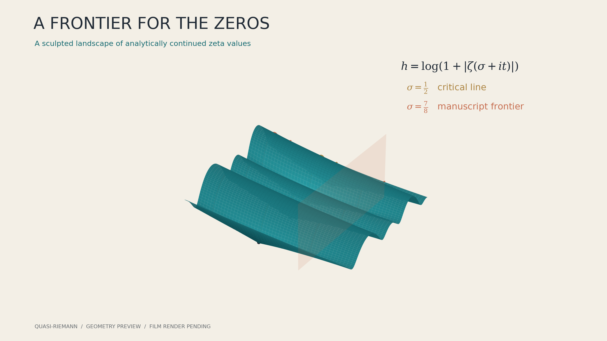
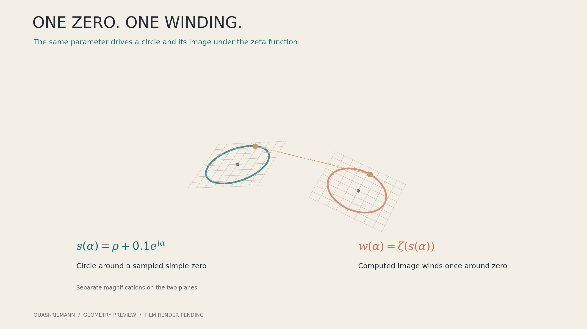

# A Frontier for the Zeros

A flagship film for **OpenAI Mathematics in 3D**, built through the existing
Codex SDK / GPT-6 Astra pipeline from manuscript family 003.

Warm bone backgrounds. Petrol-blue zeta landscapes. Copper phase curves.
Gold critical-line geometry. The camera travels through actual 3D surfaces
and closes in on the LaTeX at the moment its meaning becomes visible.

The central question: **how can an argument exclude every zero beyond one
fixed frontier, at every height?** The film moves from primes to complex
geometry, through a local phase-winding closeup, into the manuscript's
reciprocal-L continuation argument. The September 30 paper reports the
frontier `Re(s)>7/8`; the full Riemann hypothesis remains open in the source.

## Geometry previews

These still studies plot the actual numerical geometry specified by the
Astra dossier. They show the planned palette and mathematical compositions;
the animated Manim render is pending.





## Production

The [source dossier](source-context.md) records the exact hypotheses,
the two-stage proof map, numerical geometry and limits of the explanation.
The [production brief](prompt.txt) targets a 210-230 second silent film at
1920x1080 and 60 fps. A scene or storyboard alone is not a completed film.

```bash
python scripts/drive_astra_mcp.py papers/quasi-riemann --quality h --effort max --review-mode off --no-render
python scripts/export_paper_candidate.py papers/quasi-riemann runs/astra/<run-id>
```

Authoring and independent evidence audits use `gpt-6-astra` with Codex
ChatGPT login. This episode uses Jev-off mode because TypeSafe credentials
are unavailable. It retains Astra audits and claims no Jev approval.

After an authored candidate is retained as `candidate.json`, dispatch
**Quasi-Riemann preview and final film** in GitHub Actions. Two independent
cloud jobs render the same source: a 480p/15 fps inspection copy and a
1080p/60 fps delivery. These jobs make no model calls and receive no model
credentials. Each saves the MP4, a source-bound manifest, 12 sampled frames,
contact sheet, metadata and execution logs for 30 days. Failures retain their
available evidence as well.

Cloud render-existing output is `not_reviewed`. Inspection of stills covers
composition and readability; continuous playback is needed to assess motion.
Only a completed manifest and actual MP4 establish a completed render.

## Attribution

OpenAI, *The Quasi-Riemann Hypothesis: A Zero-Free Half-Plane Re(s)>7/8*,
September 30, 2026. [Pinned manuscript](https://github.com/HarleyCoops/math/blob/adc7f1241b42e322a6451854ab7e4b4c146bf78a/preprints/The-Quasi-Riemann-Hypothesis-September-30-2026/paper.pdf).
The source reports Lean formalizations for specified results. This project
has not independently checked the complete proof or rebuilt those artifacts.
