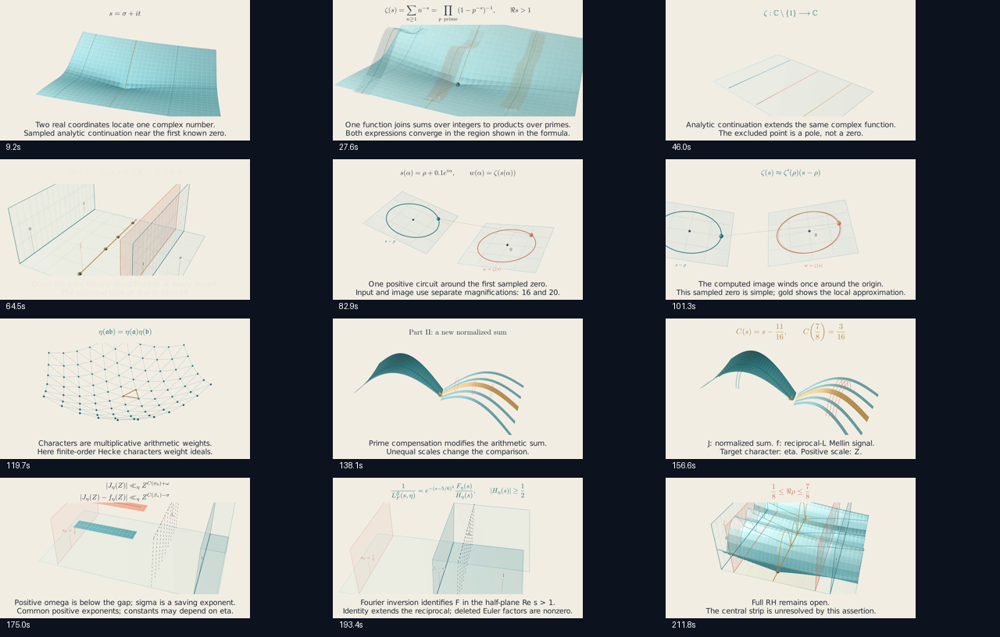
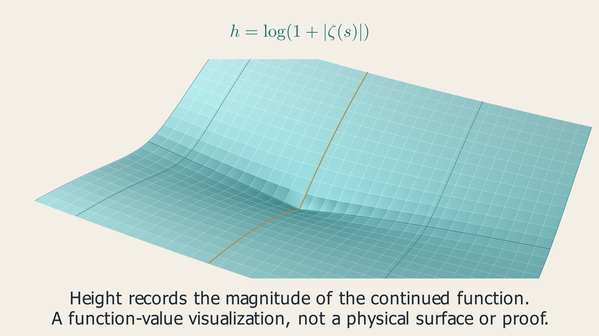
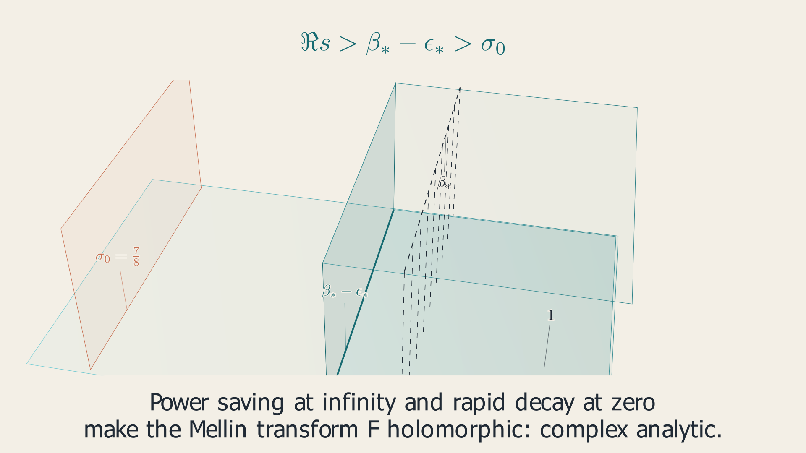
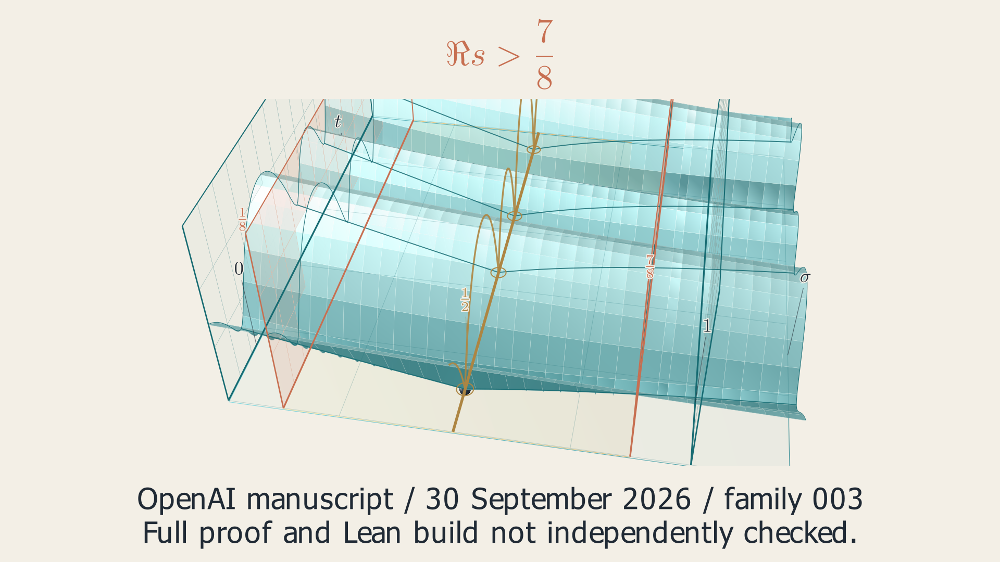

# A Frontier for the Zeros

A flagship film for **OpenAI Mathematics in 3D**, built through the existing
Codex SDK / GPT-6 Astra pipeline from manuscript family 003.

Warm bone backgrounds. Petrol-blue zeta landscapes. Copper phase curves.
Gold critical-line geometry. The camera travels through actual 3D surfaces
and closes in on the LaTeX at the moment its meaning becomes visible.

The central question: **how can an argument exclude every zero beyond one
fixed frontier, at every height?** The film moves from primes to complex
geometry, through a local phase-winding closeup, into the manuscript's
reciprocal-L continuation argument. The September 30 paper reports the
frontier `Re(s)>7/8`; the full Riemann hypothesis remains open in the source.

## Complete film

**221.03 seconds, 1280×720 at 30 fps**, rendered on GitHub Actions from the
retained Astra candidate. The completed manifest, exact source binding and
movie hash were verified; the entire MP4 decoded without errors.

[Watch or download the complete film](https://github.com/HarleyCoops/Math-To-Manim/releases/download/quasi-riemann-film-2026-10-07/quasi-riemann-720p.mp4) ·
[Public render evidence](https://github.com/HarleyCoops/Math-To-Manim/releases/tag/quasi-riemann-film-2026-10-07) ·
[Astra bundle pathway](../../docs/ASTRA_BUNDLE.md)



The cloud render made zero model calls and retains `not_reviewed` status.
The earlier Astra authoring and source audits remain separate. Sampled frames
cover composition and readability; no Jev approval or continuous-motion
certification is claimed. See the [completed cloud manifest](production/cloud-render-manifest.json)
and [delivery verification](production/film-evidence.json).

## Actual execution stills

The current 220-second Astra scene completes a real Manim execution probe.
These images show selected scene states and the final frame, with the
formula band and continuation labels corrected. They are execution stills;
the completed cloud movie is linked above.







[Retained scene](scene.py) · [Authoring and source audits](production.json) ·
[Execution evidence](production/execution-stills.json)

## Geometry previews

These still studies plot the actual numerical geometry specified by the
Astra dossier. They show the planned palette and mathematical compositions;
the completed Manim film is linked above.


## Production

The [source dossier](source-context.md) records the exact hypotheses,
the two-stage proof map, numerical geometry and limits of the explanation.
The [production brief](prompt.txt) targets a 210-230 second silent film.
The user's latest delivery choice is **1280x720 at 30 fps**, superseding the
original 1080p/60 fps authoring brief. The renderer applies this delivery
profile after loading the retained scene. A scene or storyboard alone is
not a completed film.

```bash
python scripts/drive_astra_mcp.py papers/quasi-riemann --quality h --effort max --review-mode off --no-render
python scripts/export_paper_candidate.py papers/quasi-riemann runs/astra/<run-id>
```

Authoring and independent evidence audits use `gpt-6-astra` with Codex
ChatGPT login. This episode uses Jev-off mode because TypeSafe credentials
are unavailable. It retains Astra audits and claims no Jev approval.

The authored candidate is retained as `candidate.json`. Dispatch
**Quasi-Riemann preview and final film** in GitHub Actions. Two independent
cloud jobs render the same source: a 480p/15 fps inspection copy and a
720p/30 fps delivery. These jobs make no model calls and receive no model
credentials. Each saves the MP4, a source-bound manifest, 12 sampled frames,
contact sheet, metadata and execution logs for 30 days. Failures retain their
available evidence as well.

Cloud render-existing output is `not_reviewed`. Inspection of stills covers
composition and readability; continuous playback is needed to assess motion.
Only a completed manifest and actual MP4 establish a completed render.

## Attribution

OpenAI, *The Quasi-Riemann Hypothesis: A Zero-Free Half-Plane Re(s)>7/8*,
September 30, 2026. [Pinned manuscript](https://github.com/HarleyCoops/math/blob/adc7f1241b42e322a6451854ab7e4b4c146bf78a/preprints/The-Quasi-Riemann-Hypothesis-September-30-2026/paper.pdf).
The repository also publishes the [original LaTeX manuscript](https://github.com/HarleyCoops/math/blob/adc7f1241b42e322a6451854ab7e4b4c146bf78a/preprints/The-Quasi-Riemann-Hypothesis-September-30-2026/build/paper.tex).
Astra reads that source directly. The continuation argument's displayed
formulas come from Proposition 2.1 and its proof, including the equation
labels `eq:common-residue`, `eq:low-probe-contract`,
`eq:high-probe-contract` and `eq:uniform-saving`.
Manim typesets selected expressions with `MathTex`; explanatory labels and
local numerical examples are added for the film and are not manuscript excerpts.
The source reports Lean formalizations for specified results. This project
has not independently checked the complete proof or rebuilt those artifacts.
